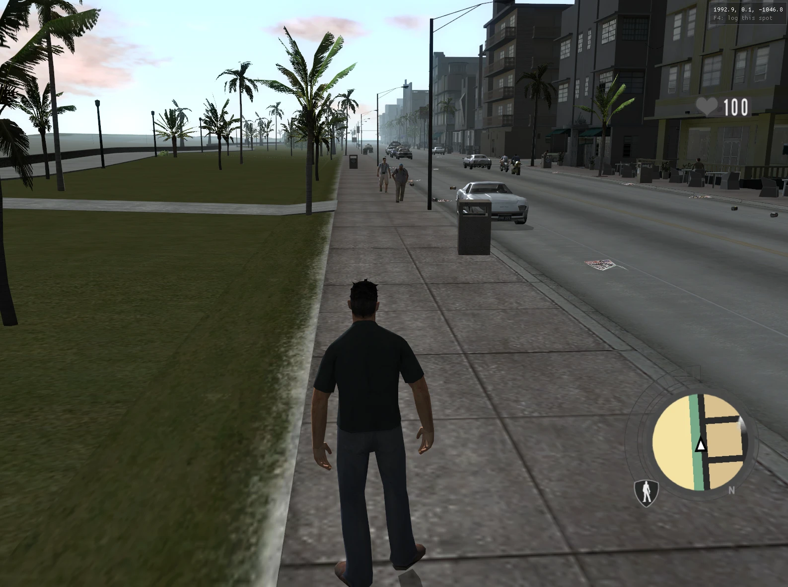

# DPL3 Extended hook BY E75 (beta 0.1)

**Driv3r's Miami in Driver Parallel Lines.** Drive and walk through Driv3r's Miami with Driv3r's cars, in Parallel Lines' engine, with Tanner or the Kid as your character.

This is an early beta. Hobby project with an open licence: free to use, change and build on. If you use it, please mention **E75** (GitHub name).

## What it does
A converter script reads your own copies of Driver Parallel Lines and Driv3r and builds Driv3r's Miami for Parallel Lines. A small hook (an ASI plugin) adds the extras and an in-game window.

- **Miami**: Driv3r's streets, buildings, roads, traffic lights and sea in Parallel Lines, started from **D3 DLC** on the title screen.
- **Driv3r cars**: Miami's cars are added as new vehicles, and Miami's own traffic uses them.
- **Driv3r handling, mass and damage** for the car you drive (optional).
- **Driv3r moves** on foot: walk, run, swim, climb ladders, jump and roll (optional).
- **Player character**: Tanner (Driv3r) or the Kid (Parallel Lines).
- **Weather**: Parallel Lines' own, or rain with wet roads.
- **Time of day**: any hour, or a 24-hour cycle at the pace you choose (real minutes per game hour).
- **Camera**: a 360 degree orbit camera for vehicles, and a free camera.
- **Gamepad menu**: Back + Start opens the window, the sticks move the cursor, A clicks.

## How it works
1. **Convert**: `Convert-Miami.ps1` runs a set of Python scripts on your own game files. They read Driv3r's Miami (models, textures, collision, roads, cars, animations, Tanner) and write it in Parallel Lines' file formats next to the original files: a Miami city file, a vehicle pack with the Driv3r cars, a Tanner character pack, an animation bank, a HUD, an overhead map and the title menu entry. Your original files are not touched.
2. **Hook**: `DPLHookExtended.asi` is a plugin that Parallel Lines loads at start-up (through an ASI loader). It adds the D3 DLC entry to the title menu, tells the game to use the converted files for Miami, and runs the extras: Driv3r handling and damage, Driv3r moves, weather, time of day, cameras and the hook window.
3. **Play**: start the game, choose **D3 DLC**, then **Miami**. The window (F2) switches the extras on and off while you play.

## Status: beta 0.1
Only **Miami** is in this version. **Nice** and **Istanbul** are **coming soon**: they are in the works, but still have quite a few bugs. They will be added when the worst of those are fixed.
Expect rough edges in Miami too. This is the first public version and it grows step by step.

## What you need
1. **Driver Parallel Lines** (PC) with an **ASI loader** in the game folder (a `dinput8.dll`, for example [Ultimate ASI Loader](https://github.com/ThirteenAG/Ultimate-ASI-Loader)). It loads `.asi` plugins at start-up. [DPLHook](https://github.com/ermaccer/dplhook) brings one too, but you do not need DPLHook itself.
2. **Driv3r** (PC), patched to **version 1.20**. Nothing of Driv3r is included here: the installer reads your own copy.
3. **Python 3.10 or newer** from [python.org](https://www.python.org/downloads/). Tick **Add python.exe to PATH** in the installer.
   Then open PowerShell and run once: `python -m pip install numpy Pillow`
4. About **6 GB** of free disk space on the drive of Driver Parallel Lines (the result takes about 2 GB).

## Install (about 5 to 20 minutes)
1. Close Driver Parallel Lines.
2. Download this repository (green **Code** button, **Download ZIP**, or the zip under **Releases**) and unzip it anywhere.
3. Right-click `Convert-Miami.ps1` and choose **Run with PowerShell**. If Windows blocks it, open PowerShell in this folder and run:
   `powershell -ExecutionPolicy Bypass -File .\Convert-Miami.ps1`
4. Answer the two questions:
   - the folder of Driver Parallel Lines (the one with `DriverParallelLines.exe`)
   - the folder of Driv3r (the one with `Driv3r.exe`)
5. Wait until it says **All done**. It numbers every step and tells you in plain words what is wrong if something fails.
6. Start the game, choose **D3 DLC** on the title screen, then **Miami**.

Your original game files are never changed. `Cities\levels.txt` is backed up to `_backup\<date>\` inside the game folder first.
Running the script again is safe: it rebuilds everything.

## The hook window
Open it with **F2** (or **Back + Start** on a pad).
- **Camera**: orbit camera, free camera.
- **Driv3r**: handling and mass, damage, walk / run / swim / roll / jump.
- **Weather**: time of day (an hour, or the 24-hour cycle with real minutes per hour) and Normal or Rain.
- **Player character**: Kid or Tanner.

Defaults: 12:00 (noon), Parallel Lines' own weather, no 24-hour cycle.

## When something goes wrong
Two log files tell what happened. Send both when you ask for help:
- `Convert-Miami.log` next to the script (and a copy `DPLHookExtended.install.log` in the game folder): the installation.
- `DPLHookExtended.log` in the game folder: the hook while the game runs. It starts with the edition and every setting, and notes every change you make in the window.

Common messages:
- *Python was not found*: install Python (step 3 above) and open a new PowerShell window.
- *Python needs two add-ons*: run `python -m pip install numpy Pillow`.
- *Driv3r.exe is ... bytes, version 1.20 is 4288512*: patch Driv3r to version 1.20.
- *Driver Parallel Lines is running*: close the game.

## Remove
Delete `DPLHookExtended.asi`, `DPLHookExtended.ini`, `DPLHookExtended.log` and `DPLHookExtended.install.log` from the game folder.
The converted files are `Cities\miami_pc.d4c`, `Vehicles\nyc_d3_vehicles.sp`, `Characters\nyc_d3.sp`, `anims\nyc_now_d3.an4`,
`Overlays\HUD-MIAMI.*`, `Overlays\miami.map`, `GUI\D3FRONT.*` and the folder `Mods\Cars\D3`. Copy `levels.txt` back from `_backup\<date>\`.

## Credits and licence
Made by **E75** (GitHub). Hobby project with an open licence: free to use, change and build on; if you use it, credit E75 (GitHub name).
Thanks to ermaccer for [DPLHook](https://github.com/ermaccer/dplhook), the original script hook for Driver Parallel Lines. This hook runs with or without it.

Driver Parallel Lines and Driv3r belong to Ubisoft and Reflections; this project is not affiliated with them and ships none of their files.
